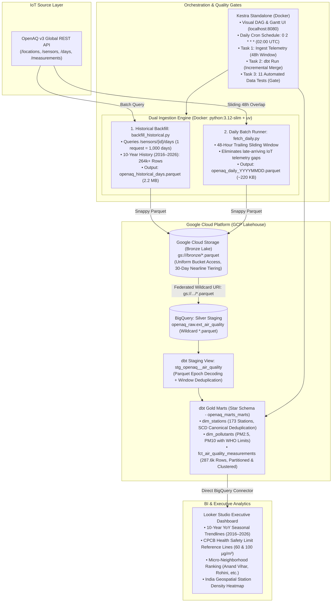

# 🌍 End-to-End Cloud Data Platform (OpenAQ Telemetry)

[](https://cloud.google.com/)
[](https://www.terraform.io/)
[](https://cloud.google.com/bigquery)
[](https://www.getdbt.com/)
[](https://kestra.io/)
[](https://www.docker.com/)
[](https://www.python.org/)

An enterprise-grade, autonomous cloud-native ELT telemetry platform designed to ingest, model, validate, orchestrate, and visualize **10 years of air quality telemetry (287,600+ records)** across **173 active monitoring stations** and **130 local neighborhoods** in 6 major Indian metropolitan hubs: **Delhi, Mumbai, Pune, Bengaluru, Hyderabad, and Solapur**.

---

## 🏛️ System Architecture



---

## 🛠️ Tech Stack & Key Architectural Decisions

| Layer | Technology | Engineering Rationale |
| :--- | :--- | :--- |
| **Infrastructure as Code** | **Terraform** | Declarative cloud provisioning for multi-region GCS buckets and BigQuery datasets. Uniform Bucket-Level Access and 30-day Nearline lifecycle cost automation. |
| **Security & Auth** | **Application Default Credentials (ADC)** | Complying with GCP's `iam.disableServiceAccountKeyCreation` policy to eliminate static JSON private keys on developer machines; embedded in Docker runtime for seamless BigQuery auth. |
| **Data Lake (Bronze)** | **Google Cloud Storage (GCS)** | Immutable raw archive; batch loading from GCS to BigQuery is **\$0.00 free** vs \$0.05/GB BigQuery streaming. |
| **Dual Ingestion Pattern** | **Python 3.12 (`uv`)** | Solves API rate limits by pairing pre-aggregated `/days` backfill (264k+ rows in 45s) with a **48-hour trailing sliding window** to guarantee zero data loss from delayed IoT buffer dumps. |
| **Orchestration** | **Kestra (Slim Edition)** | Modern declarative DAGs-as-Code (`flows/openaq_daily_telemetry.yml`) with real-time UI (`localhost:8080`), automatic retries, and daily cron scheduling (`0 2 * * *`). |
| **Containerization** | **Docker Multi-Stage** | Multi-stage build accelerated with `uv` (~175 MB compressed image), encapsulating Python, `dbt-bigquery`, and GCP ADC credentials. |
| **Data Warehouse** | **Google BigQuery** | Serverless columnar OLAP with daily table partitioning (`measurement_date`) and multi-column clustering (`city, local_area, pollutant`). |
| **Data Modeling & QA** | **dbt Core (v1.12)** | Star schema modeling with window-based idempotent deduplication (`QUALIFY ROW_NUMBER()`), SCD canonical station ranking, and **11 automated data tests**. |
| **BI & Analytics** | **Looker Studio** | Executive dark-themed dashboard tracking city-to-neighborhood pollution disparity and multi-year winter pollution spikes against CPCB limits. |

---

## 📊 Star Schema Dimensional Model

```
                    [ dim_stations ]
                  (Primary Key: station_id)
                  - station_name
                  - city (Delhi, Mumbai, Pune, Bengaluru, Hyderabad, Solapur)
                  - local_area (130 Neighborhoods: Anand Vihar, Rohini, Pashan, etc.)
                  - latitude, longitude
                  - total_sensors_tracked
                  - first_recorded_at, latest_recorded_at
                            │
                            │ (1:N)
                            ▼
           [ fct_air_quality_measurements ]
         (Primary Key: measurement_id - Farm Fingerprint)
         - Foreign Key: station_id
         - Foreign Key: sensor_id
         - city
         - local_area
         - pollutant (pm25, pm10)
         - measurement_value (µg/m³)
         - measured_at_utc (Timestamp)
         - measurement_date (Date)
         - ingested_at_utc (Timestamp)
         --------------------------------------------------
         PARTITION BY: measurement_date (Daily Partitioning)
         CLUSTER BY:   city, local_area, pollutant
                            ▲
                            │ (N:1)
                            │
                    [ dim_pollutants ]
                  (Primary Key: pollutant)
                  - display_name
                  - units (µg/m³)
                  - health_description
                  - who_annual_safe_limit_ugm3
```

---

## 🧪 Automated Data Quality Testing (11 Quality Gates)

Every pipeline execution automatically enforces **11 automated dbt data tests** before marking the run green:

* **Primary Key Uniqueness (3):** Strict uniqueness on `dim_stations.station_id`, `dim_pollutants.pollutant`, and surrogate key `fct_air_quality_measurements.measurement_id`.
* **Not Null Constraints (5):** Guaranteed zero nulls on critical IDs, measurements, and timestamps.
* **Referential Integrity (1):** Foreign key constraint verifying every measurement links to an authentic station in `dim_stations`.
* **Accepted Values (1):** Restricts pollutants strictly to `['pm25', 'pm10']`.

```text
Finished running 11 data tests in 13.54s.
Completed successfully. Done. PASS=11 WARN=0 ERROR=0 SKIP=0 TOTAL=11
```

---

## 🚀 Reproduction & Setup Guide

### 1. Prerequisites
* Python 3.12 (`uv` recommended)
* Google Cloud SDK (`gcloud`)
* Terraform >= 1.5.0
* Docker & Docker Compose

### 2. Configure Environment & Credentials
```bash
# Clone the repository
git clone https://github.com/<your-username>/OPEN-AQ-Telemetry-Platform.git
cd OPEN-AQ-Telemetry-Platform

# Setup environment variables from template
cp .env.example .env
# Edit .env with your OPENAQ_API_KEY and GCP_PROJECT_ID

# Authenticate GCP via Application Default Credentials
gcloud auth login
gcloud auth application-default login
gcloud auth application-default set-quota-project YOUR_PROJECT_ID
```

### 3. Provision Cloud Infrastructure (Terraform)
```bash
cd terraform
terraform init
terraform plan
terraform apply
cd ..
```

### 4. Run 10-Year Historical Backfill
```bash
python ingestion/backfill_historical.py
# Pulls 264k+ daily measurements (2016-2026) across 173 stations and uploads to GCS
```

### 5. Launch Autonomous Orchestration (Kestra in Docker)
```bash
docker compose up -d kestra
# Access Kestra Web UI at http://localhost:8080
# The flow runs daily at 02:00 UTC, or click 'Execute' on-demand
```

---

## 📖 In-Depth Documentation

* **[System Architecture Deep-Dive](docs/ARCHITECTURE.md):** Detailed design analysis on 12-factor principles, FinOps calculations, and rate-limit bypass strategies.
* **[Data Dictionary & Schema Contracts](docs/DATA_DICTIONARY.md):** Complete field-level definitions, types, descriptions, and constraints for all dimensional models.
