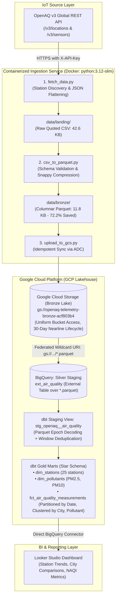

# 🌍 End-to-End Cloud Data Platform (OpenAQ Telemetry)

[](https://cloud.google.com/)
[](https://www.terraform.io/)
[](https://cloud.google.com/bigquery)
[](https://www.getdbt.com/)
[](https://www.docker.com/)
[](https://www.python.org/)

An enterprise-grade, cloud-native ELT data platform designed to ingest, process, model, and visualize real-time air quality telemetry across major metropolitan hubs in India: **Pune, Mumbai, Delhi, Bengaluru, Hyderabad, and Solapur**.

---

## 🏛️ System Architecture



---

## 🛠️ Tech Stack & Key Architectural Decisions

| Layer | Technology | Engineering Rationale |
| :--- | :--- | :--- |
| **Infrastructure as Code** | **Terraform** | Declarative cloud provisioning for GCS buckets and BigQuery datasets. Uniform Bucket-Level Access and 30-day Nearline lifecycle cost automation. |
| **Security & Auth** | **Application Default Credentials (ADC)** | Complying with GCP's `iam.disableServiceAccountKeyCreation` policy to eliminate static JSON private keys on developer machines. |
| **Data Lake (Bronze)** | **Google Cloud Storage (GCS)** | Immutable raw archive; batch loading from GCS to BigQuery is \$0.00 free vs \$0.05/GB BigQuery streaming. |
| **Ingestion Engine** | **Python 3.12 (`uv`)** | Two-stage decoupled ingestion (CSV $\rightarrow$ Parquet) achieving **72.2% storage reduction** using Snappy block compression. |
| **Containerization** | **Docker (Multi-Stage)** | Slim runtime image based on `python:3.12-slim` (~150 MB), isolating C-build tools from production. |
| **Data Warehouse** | **Google BigQuery** | Serverless columnar OLAP with daily table partitioning (`measurement_date`) and multi-column clustering (`city, pollutant`). |
| **Data Modeling** | **dbt Core (v1.12)** | Star schema modeling with window-based idempotent deduplication (`QUALIFY ROW_NUMBER()`) and **11 automated data tests**. |
| **BI & Analytics** | **Looker Studio** | Native BigQuery connection leveraging cluster-pruned sub-second queries for telemetry visualization. |

---

## 📊 Star Schema Dimensional Model

```
                     [ dim_stations ]
                   (Primary Key: station_id)
                   - station_name
                   - city (Pune, Mumbai, Delhi, Bengaluru, Hyderabad, Solapur)
                   - latitude, longitude
                   - total_sensors_tracked
                   - first_recorded_at, latest_recorded_at
                            │
                            │ (1:N)
                            ▼
           [ fct_air_quality_measurements ]
         (Primary Key: measurement_id - Farm Fingerprint)
         - Foreign Key: station_id
         - Foreign Key: sensor_id
         - city
         - pollutant (pm25, pm10)
         - measurement_value (µg/m³)
         - measured_at_utc (Timestamp)
         - measurement_date (Date)
         - ingested_at_utc (Timestamp)
         --------------------------------------------------
         PARTITION BY: measurement_date (Daily Partitioning)
         CLUSTER BY:   city, pollutant
                            ▲
                            │ (N:1)
                            │
                    [ dim_pollutants ]
                  (Primary Key: pollutant)
                  - display_name
                  - units (µg/m³)
                  - health_description
                  - who_annual_safe_limit_ugm3
```

---

## 🧪 Automated Data Quality Testing (11 Tests)

All models are continuously tested using dbt:

* **Uniqueness (3):** Primary key uniqueness on `dim_stations.station_id`, `dim_pollutants.pollutant`, and surrogate key `fct_air_quality_measurements.measurement_id`.
* **Not Null (5):** Strict enforcement on all IDs, measurements, and timestamps.
* **Referential Integrity (1):** Foreign key `relationships` test enforcing every measurement links to a valid station in `dim_stations`.
* **Accepted Values (1):** Ensures `pollutant` contains only `['pm25', 'pm10']`.

```text
Finished running 11 data tests in 6.59s.
Done. PASS=11 WARN=0 ERROR=0 SKIP=0 TOTAL=11
```

---

## 🚀 Reproduction & Setup Guide

### 1. Prerequisites
* Python 3.12 (`uv` recommended)
* Google Cloud SDK (`gcloud`)
* Terraform >= 1.5.0
* Docker & Docker Compose

### 2. Configure Environment & Credentials
```bash
# Clone the repository
git clone https://github.com/YaadiY/OPENAQ_GCP_Platform.git
cd OPENAQ_GCP_Platform

# Setup environment variables
cp .env.example .env
# Edit .env with your OPENAQ_API_KEY and GCP_PROJECT_ID

# Authenticate GCP via Application Default Credentials
gcloud auth login
gcloud auth application-default login
gcloud auth application-default set-quota-project YOUR_PROJECT_ID
```

### 3. Provision Cloud Infrastructure (Terraform)
```bash
cd terraform
terraform init
terraform plan
terraform apply
cd ..
```

### 4. Run Containerized Ingestion Pipeline (Docker)
```bash
docker compose up --build
```

### 5. Create BigQuery External Table & Run dbt
```bash
# Create BigQuery external table over GCS wildcard Parquet URIs
python ingestion/create_external_table.py

# Run and test dbt models
cd dbt
dbt debug --profiles-dir .
dbt run --profiles-dir .
dbt test --profiles-dir .
```

---

## 📚 Study Documentation & Interview Preparation

Comprehensive, self-contained study guides and interview playbooks are preserved in:
* **Architecture Guide:** [`C:\Users\yeleg\VS\Study_docs\openaq_gcp_platform_architecture_guide.md`](file:///C:/Users/yeleg/VS/Study_docs/openaq_gcp_platform_architecture_guide.md)
* **Interview Playbook (14 Questions with Junior vs. Senior Answers):** [`C:\Users\yeleg\VS\Study_docs\openaq_interview_playbook.md`](file:///C:/Users/yeleg/VS/Study_docs/openaq_interview_playbook.md)
