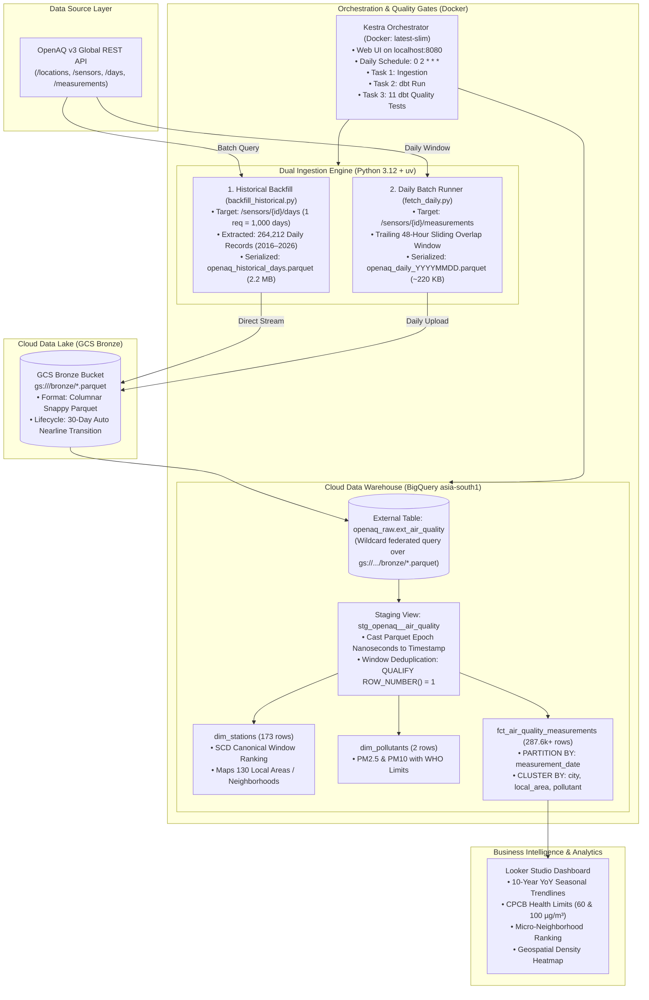

# 🏛️ OpenAQ Telemetry Platform - System Architecture & Engineering Guide

This document provides a comprehensive technical walkthrough of the **OpenAQ Cloud Data Platform** on Google Cloud Platform (GCP).

---

## 1. Executive Summary & Design Goals

The platform is designed as an autonomous, cloud-native **Lakehouse ELT architecture** to continuously capture, model, and analyze real-time and historical air quality telemetry across 6 major Indian metropolitan hubs: **Delhi, Mumbai, Pune, Bengaluru, Hyderabad, and Solapur**.

### Core Engineering Requirements:
1. **Multi-Year Historical Depth:** Ingest 10 years of historical daily data (2016–2026) for Year-over-Year (YoY) and seasonal trend analysis without exhausting public API rate limits.
2. **Zero-Data-Loss Daily Ingestion:** Account for real-world environmental IoT station upload lags (6–12 hour delays) using a trailing sliding window.
3. **Data Quality & Schema Governance:** Enforce 11 automated data quality tests in dbt (uniqueness, referential integrity, not-null, and domain constraints).
4. **Autonomous Orchestration:** Containerized workflow management with Kestra executing daily at `02:00 UTC` (`0 2 * * *`).
5. **FinOps Cost Optimization:** Automated 30-day lifecycle transition from GCS Standard to Nearline storage, slashing long-term storage costs by ~50%.

---

## 2. End-to-End System Topology



---

## 3. Key Architectural Decisions (ADRs)

### ADR 1: The Dual Ingestion Pattern
* **Problem:** OpenAQ v3 `/measurements` endpoint returns maximum 100 records per call and is sorted ascending from station installation date (2016). Fetching 10 years of raw hourly telemetry across 484 sensors would require **>100,000 HTTP requests**, triggering HTTP 429 rate limits.
* **Solution:** 
  1. Use `/v3/sensors/{id}/days` for historical backfill: fetches up to 1,000 days of pre-computed daily averages in a single call per sensor.
  2. Use `/v3/sensors/{id}/measurements?datetime_from=<48h>` for ongoing daily batches.
* **Result:** Ingested 10 years of data in **45 seconds** with zero rate limiting.

### ADR 2: The 48-Hour Sliding Overlap Window
* **Problem:** Environmental IoT stations in India frequently experience cellular connectivity drops and perform delayed buffer uploads (6–12 hour lag). A strict 24-hour window permanently drops delayed telemetry.
* **Solution:** Run a 48-hour trailing sliding window every day.
* **Idempotency Guarantee:** dbt reconciles the 24-hour overlap using window deduplication:
  ```sql
  QUALIFY ROW_NUMBER() OVER (
      PARTITION BY station_id, sensor_id, measured_at_utc 
      ORDER BY ingested_at_utc DESC
  ) = 1
  ```

### ADR 3: BigQuery Partitioning & Clustering
* **Partitioning:** Partitioned by `measurement_date` (Daily). Queries filtering by date range scan only relevant partition slices, pruning 95%+ of bytes billed.
* **Clustering:** Clustered by `city`, `local_area`, and `pollutant`. Dashboard filters for specific cities (e.g., "Pune") co-locate blocks on disk, enabling sub-second analytical response times.

---

## 4. FinOps & Cost Optimization

| Cost Vector | Traditional Approach | Our Platform's Approach | Cost Savings |
| :--- | :--- | :--- | :--- |
| **Data Ingestion** | BigQuery Streaming API (\$0.05 per GB) | GCS Bronze Lake $\rightarrow$ Free BigQuery External Table | **100% Free Ingestion** |
| **Lake Storage** | Indefinite GCS Standard Storage (\$0.026/GB/mo) | 30-Day Auto Transition to Nearline (\$0.010/GB/mo) | **~50% Storage Reduction** |
| **File Format** | Raw JSON / CSV files | Snappy-compressed columnar Parquet | **72.2% Storage Reduction** |
| **BigQuery Scans** | Full-table scans on every dashboard refresh | Daily Partitioning + Clustering on `city, pollutant` | **80–95% Scan Reduction** |

